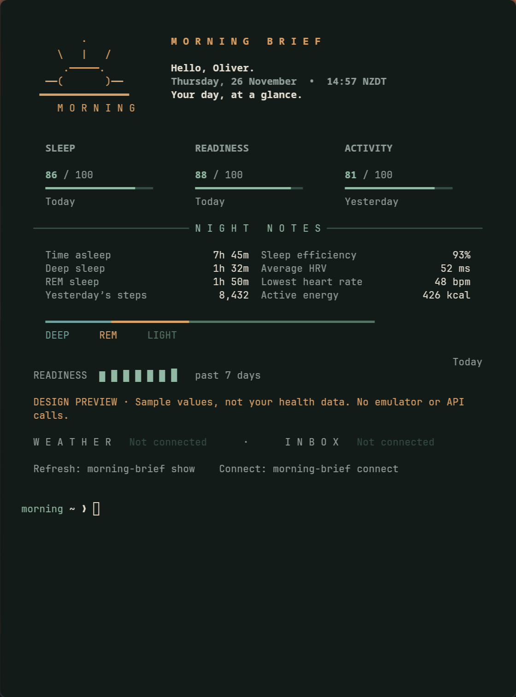

# Morning Brief

A personal, local-first Linux terminal dashboard for Oura sleep, readiness and
activity data. A transparent, fastfetch-inspired briefing prints above a normal
interactive shell. Weather and email integrations are not implemented.

**Website:** https://oliw07.github.io/morning-brief/

**Privacy policy:** https://oliw07.github.io/morning-brief/privacy.html

## Screenshot



Actual terminal screenshot using explicitly labelled **sample data**, not live
Oura records. Captured against an opaque background for legibility and desktop
privacy; the installed widget supports a transparent background.

## Status

This is the source of a personal Hyprland/Kitty dashboard, not a hosted health
service or an official Oura product. OAuth integration is implemented, but live
account authorization and end-to-end API sync still need verification. Sample
previews are explicitly labelled and do not represent anyone's real data.

The current morning launcher expects a separately configured local Android
emulator and Bluetooth service; this repository does not install those privileged
components. The ordinary dashboard/API commands do not need an emulator.

## Local use

Python 3.11+ and Kitty on Linux are required (the automatic trigger is currently
Hyprland-specific). Clone to `~/.local/share/morning-brief`, or use a working copy:

```sh
python3 -m venv .venv
.venv/bin/pip install -r requirements.txt
.venv/bin/python -m brief show --demo
.venv/bin/python -m brief connect
.venv/bin/python -m brief show
.venv/bin/python -m brief terminal
```

`terminal` prints the dashboard then replaces itself with your interactive shell.
`show` prints once. `fetch` refreshes the local cache. `preview`/`open` expect a
local `~/.local/bin/morning-brief` wrapper and Kitty. Setup-specific automation
is deliberately not installed by cloning this repository.

## Oura application registration

Register your own personal application at https://developer.ouraring.com/:

| Field | Value |
| --- | --- |
| Name | Morning Brief |
| Website | https://oliw07.github.io/morning-brief/ |
| Privacy policy | https://oliw07.github.io/morning-brief/privacy.html |
| Redirect URI | `http://127.0.0.1:8765/callback` |
| Permission | `daily` |
| Description | Personal local terminal dashboard displaying my Oura sleep, readiness and activity summaries. Data is fetched directly from Oura and stored only on my computer. |

Run `python -m brief connect` inside the virtual environment and enter the client
ID and secret locally. Authorize in your browser. Do not commit credentials or
paste them into GitHub issues. Oura decides registration/approval eligibility;
publishing this site does not guarantee approval. Gen3/newer API access requires
active Oura membership. The loopback redirect must be accepted and registered
exactly as shown; do not substitute the public website as the OAuth callback.

The client requests only the `daily` scope, uses authorization code flow with
PKCE and state verification, and refreshes tokens automatically. Tokens and the
client secret are owner-readable local files, not encrypted storage. Local users
with sufficient OS privileges can read them. No credentials are bundled.

## Sync and Bluetooth

The API reads Oura Cloud, not the ring. Data must first sync through the Oura app.
The personal emulator setup briefly borrows the laptop's adapter, interrupting
Fedora Bluetooth devices, and shuts Android down before returning the adapter.
It cannot share one physical adapter simultaneously. First daily use is tracked
from 03:00 local time. A failed or late sync is explicitly labelled; old records
are not presented as today's. No background automation is enabled by this repo.

## Development

```sh
.venv/bin/python -m unittest discover -s tests -v
```

The test suite uses mocks/sample data, not real account credentials. Please report
code issues at https://github.com/OliW07/morning-brief/issues without including
health data, tokens, client secrets or private logs.

Documentation: https://cloud.ouraring.com/v2/docs and
https://cloud.ouraring.com/docs/authentication.
